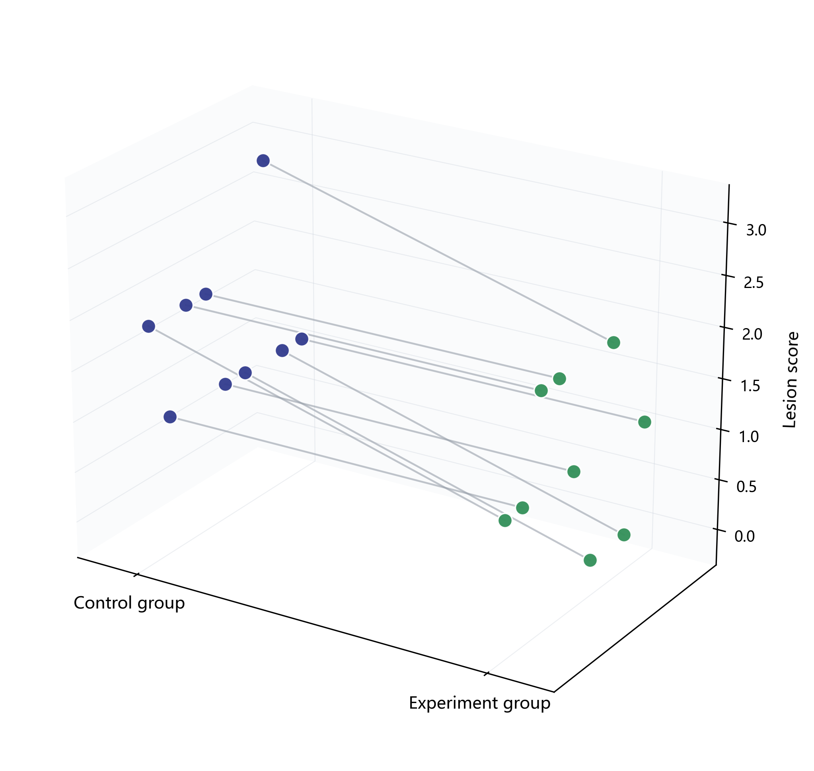

# Paired depth plot (2.5D)

[](https://github.com/misland4/--paired_depth_plot-2.5D/actions/workflows/ci.yml)

A Python script for displaying overlapping paired observations with a reproducible display-only depth offset for each pair. The supplied example contains **9 control/experiment pairs**. The author confirms that each row contains matched samples from the same subject. The measured variable is **Lesion score**, a dimensionless ordinal grading.



The added depth dimension separates overlapping pairs; it is not a measured variable. Lines connect the two observations in each input row. The script does not perform significance testing.

## Contents

- [System requirements](#1-system-requirements)
- [Installation guide](#2-installation-guide)
- [Demo](#3-demo)
- [Instructions for use](#4-instructions-for-use)
- [Repository contents](#repository-contents)
- [Troubleshooting and support](#troubleshooting-and-support)
- [Data dictionary](docs/data.md)
- [Reproduction record](docs/validation.md)
- [Academic citation](#academic-citation)

## 1. System requirements

### Software dependencies and operating systems

Use **Python 3.13**. The exact tested dependencies are pinned in `requirements.txt`:

| Package | Tested version |
| --- | --- |
| NumPy | 2.3.5 |
| pandas | 2.3.3 |
| Matplotlib | 3.10.6 |
| openpyxl | 3.1.5 |

The authors confirm **Windows 11 and Python 3.13.9** as the final manuscript-method environment. The locally verified environment is **Windows 11 Pro, Python 3.13.9**. Additional automated installation, all tests and supplied-demo generation have passed on GitHub-hosted Windows, Ubuntu and macOS runners using Python 3.13. See the [reproduction record](docs/validation.md) for run links and the exact environment snapshots. Other Python versions have not been tested for this release. SciPy is not used by this script. Tests use Python's built-in `unittest`, so `pytest` is not required.

### Hardware

A standard desktop CPU is sufficient for these small inputs. No GPU, CUDA, or other non-standard hardware is required. The demo was timed on an Intel Core i5-14600KF desktop with approximately 32 GB RAM; this is the test machine, not a minimum hardware requirement.

## 2. Installation guide

### Windows PowerShell or CMD

```powershell
git clone https://github.com/misland4/--paired_depth_plot-2.5D.git paired_depth_plot-2.5D
cd paired_depth_plot-2.5D
python -m venv .venv
.venv\Scripts\python.exe -m pip install -r requirements.txt
```

The clone command supplies a local folder name without the two leading hyphens in the remote repository name. Alternatively, download and extract the repository ZIP, enter its directory, and run the last two commands. No package activation is required.

### macOS/Linux command variant

```sh
python3 -m venv .venv
.venv/bin/python -m pip install -r requirements.txt
```

Use `.venv/bin/python` in place of `.venv\Scripts\python.exe` in the following commands. The automated checks validate script execution on GitHub-hosted macOS and Ubuntu; these local virtual-environment setup commands use the standard platform layout.

**Measured installation:** creating a new Windows virtual environment took 3.4 seconds, and installing dependencies took 41.6 seconds in one run. Some wheels were cached; network speed and cache state affect these times. See the [reproduction record](docs/validation.md) for details.

## 3. Demo

### Supplied example

From the repository root, run:

```powershell
.venv\Scripts\python.exe paired_depth_plot.py --input examples/research_pairs.xlsx --output-dir output --seed 20260709
```

Expected files and console output on Windows:

```text
PNG: output\paired_depth_plot.png
SVG: output\paired_depth_plot.svg
PDF: output\paired_depth_plot.pdf
```

The PNG is saved at 300 dpi; PDF and SVG are vector outputs. SVG fonts are converted to paths for portability. The preview above shows the nine supplied pairs, with blue control points and green experiment points. Existing output files with the same names are overwritten.

**Measured runtime:** about **1.3 seconds** for the supplied example and all three output formats in one run on the test desktop, with dependencies already installed. This is a single-run observation, not a benchmark across machines.

### Data provenance

[Download the supplied paired workbook](examples/research_pairs.xlsx). It is a byte-for-byte copy of the supplied `Simulated dataset to demo the code(1).xlsx`, retaining the original worksheet name `Simulated dataset`. The repository filename is historical; it does not establish whether the example contains simulated or measured observations. That classification remains to be clarified for this nine-pair workbook.

The script reads the nine pairs in `B2:C10` without changing scores or row order. Each row is a within-subject pair. Sequential display IDs are assigned because the workbook has no subject-ID column; nine pairs do not establish nine distinct subjects.

Specific treatments, conditions, time points and final English group names will be updated upon publication of the paper. Until then the displayed column names remain `Control group` and `Experiment group`.

## 4. Instructions for use

### Use your own Excel workbook

```powershell
.venv\Scripts\python.exe paired_depth_plot.py --input "C:/data/pairs.xlsx" --output-dir "C:/data/figures" --seed 20260709
```

The first worksheet is read using this layout:

| Excel location | Meaning |
| --- | --- |
| B1 | Header: `Control group` |
| C1 | Header: `Experiment group` |
| B2:B... | Control observations |
| C2:C... | Corresponding experiment observations |

Column A is unused. Each row must contain the two observations belonging to the same pair. Entirely blank rows are skipped; half-empty rows and non-finite/non-numeric scores are rejected. Numeric cells or formulas with cached numeric results are required. All complete rows after the headers are read; no fixed nine-row limit is imposed.

### CSV alternative with explicit IDs

```powershell
.venv\Scripts\python.exe paired_depth_plot.py --input "C:/data/pairs.csv" --output-dir output
```

Required columns:

```csv
ID,control,experiment
pair_01,2,1
pair_02,1,1
```

IDs must be non-empty and unique. Each row represents one complete pair. Additional columns are ignored. Pairing is not inferred from separate group files.

### Original built-in example

Running without `--input` retains the ten pairs embedded in the original supplied script:

```powershell
.venv\Scripts\python.exe paired_depth_plot.py --output-dir output_original
```

`examples/paired_values.csv` reproduces those original built-in values. It is a separate historical example and is not the new nine-pair supplied workbook. Internal `before`/`after` names are retained from that script; displayed group labels are `Control group` and `Experiment group`.

### Plot conventions and reproduction

- First group: **Control group** (blue); second group: **Experiment group** (green).
- Vertical axis: **Lesion score**, a dimensionless ordinal grading. The included values span 0–3; definitions of each grade have not been provided.
- Each input pair keeps the same depth position in both groups.
- `--seed` controls only display offsets, not observed scores. Input row order and the seed together determine the depth positions.
- `--output-dir` defaults to `output/` next to the script.
- For scores between 0 and 2, the original vertical scale is retained. Larger or smaller score ranges automatically expand the vertical limits so all observations remain visible.

To reproduce the repository preview, run the supplied demo with seed `20260709` and the pinned dependencies. Group labels describe the input columns; statistical interpretation depends on the study design.

### Checks

```powershell
.venv\Scripts\python.exe -m unittest discover -s tests -v
```

## Repository contents

| Path | Purpose |
| --- | --- |
| `paired_depth_plot.py` | Plotting command-line script |
| `examples/` | Supplied workbook and separate historical examples |
| `docs/data.md` | Data fields, provenance and interpretation limits |
| `docs/validation.md` | Independent installation/test record |
| `tests/` | Input-validation and complete-output checks |
| `.github/workflows/ci.yml` | Automated tests and demo generation |
| `requirements.txt` | Pinned direct dependencies |
| `requirements-windows-py313.lock.txt` | Complete tested Windows environment |
| `CITATION.cff` | Software citation |
| `CHANGELOG.md` | Version history |
| `LICENSE` / `LICENSES.md` | Code license and data/figure license scopes |

## Troubleshooting and support

- **Wrong input:** check paths, Excel layout and exact column headers. Excel input reads the first worksheet.
- **Missing/non-numeric values:** provide both values per row. Recalculate and save Excel formulas so cached numeric results exist.
- **Cannot write outputs:** close files held open by other applications, or choose a writable `--output-dir`.
- **Installation errors:** select Python 3.13 and install this repository's requirements. See the [tested environment](docs/validation.md).
- **Plot/input constraints:** Depth offsets are display-only. Use the same input order and `--seed` for repeatable placement; CSV IDs must be unique.

Use [GitHub Issues](https://github.com/misland4/--paired_depth_plot-2.5D/issues) to report reproducible problems; see [CONTRIBUTING.md](CONTRIBUTING.md). Confirmed data fields and scientific context deferred until publication are described in [docs/data.md](docs/data.md).

## Version and validation

Current software version: **1.0.1**. See [CHANGELOG.md](CHANGELOG.md) and [Releases](https://github.com/misland4/--paired_depth_plot-2.5D/releases) for fixed versions. Local clean-environment checks passed. The badge above links to automated checks; consult each platform job for actual passing results.

## Authors

Project creators and lead maintainers:

- Chunying Li, Email: <lichying@fmmu.edu.cn>
- Yinghan Wang, Email: <wang.yinghan@qq.com>

## Credits

We would like to thank Shuo Yang for his assistance with this project.

## Academic citation

Please cite the software using [CITATION.cff](CITATION.cff), or GitHub's **Cite this repository** panel:

Li, C., & Wang, Y. (2026). *Paired depth plot (2.5D)* (Version 1.0.1) [Computer software]. https://github.com/misland4/--paired_depth_plot-2.5D

The manuscript is **unpublished**. The authors request that users cite this code repository. Study details and the paper citation will be updated upon publication.

## License

The authors have selected **Apache License 2.0** for the code and **Creative Commons Attribution 4.0 International (CC BY 4.0)** for the supplied Excel dataset and figures exported by the code, including the README preview.

See [LICENSE](LICENSE) for the code license, [the CC BY 4.0 legal text](LICENSES/CC-BY-4.0.txt) for the data/figure license, and [LICENSES.md](LICENSES.md) for file scopes and attribution details. Cite Chunying Li and Yinghan Wang, identify this repository and the version used, link the applicable license, and indicate any changes when reusing the dataset or figures under CC BY 4.0.

These licenses cover the repository's supplied materials; users applying the scripts to other inputs must have permission to use those inputs.
